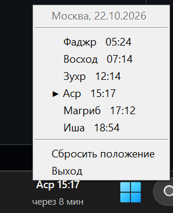

# Время намаза
### [⬇ Скачать установщик](https://github.com/SulaymonHursanov/pray-time/releases/latest/download/PrayTime-Setup.exe)

Время ближайшего намаза текстом прямо в панели задач Windows 11, слева от кнопки «Пуск».


- Показывает следующий намаз и сколько до него осталось.
- Если «Пуск» прижат к левому краю (выравнивание влево в Windows 11 или Windows 10),
  надпись стоит справа — слева от области уведомлений.
- За 10 минут до намаза приходит уведомление Windows и надпись один раз мигает зелёным.
- Когда время наступает, надпись 15 минут подсвечена зелёным и приходит уведомление Windows.
- Левой кнопкой мыши можно сдвинуть надпись относительно «Пуска» или трея (положение запоминается).
- Правая кнопка — расписание на день, выбор города, «Сбросить положение», «Выход».

| За 10 минут — мигает один раз | Время наступило — подсветка 15 минут |
|:---:|:---:|
|  |  |

Меню по правой кнопке — расписание на сегодня, текущий намаз отмечен ▶:



Город выбирается в меню по правой кнопке → «Город»: крупные города России (Москва,
Санкт-Петербург, Казань, Уфа, Махачкала, Грозный и др.), а также Ташкент, Самарканд, Бишкек,
Алматы, Астана, Душанбе и Баку. Время показывается по часовому поясу Windows.

Время считается астрономически (алгоритм PrayTimes), Аср ханафитский. Для каждой страны углы
и поправки подобраны по официальной таблице, расхождение с ней — не больше 1–2 минут:

| Города | Таблица | Фаджр | Иша |
|---|---|---|---|
| Россия | ДУМ РФ | 16° | 15° |
| Ташкент, Самарканд | [namoz-vaqti.uz](https://namoz-vaqti.uz) (Комитет по делам религий) | 15,5° | 15,5° |
| Алматы, Астана | [ДУМ Казахстана](https://muftyat.kz) | 15° | 15° |
| Бишкек | [Муфтият Кыргызстана](https://muftiyat.kg) | 18° | 16° |
| Душанбе | [Совет улемов Таджикистана](https://shuroiulamo.tj/ru/namaz) | 18° | через 90 мин после Магриба |
| Баку | Управление мусульман Кавказа | 15,75° | 14,75° |


## Установка

**[⬇ Скачать установщик](https://github.com/SulaymonHursanov/pray-time/releases/latest/download/PrayTime-Setup.exe)**
— последняя версия скачается сразу. Запустите её; новая версия ставится поверх прежней, настройки
сохраняются. Права администратора не нужны; по умолчанию включён автозапуск вместе с Windows.
Описание изменений и прежние версии — в [Releases](https://github.com/SulaymonHursanov/pray-time/releases).

Установщик не подписан, поэтому Windows может показать «Windows защитила ваш компьютер» —
нажмите «Подробнее» → «Выполнить в любом случае».

## Запуск из исходников

```
pip install comtypes pystray pillow
pythonw prayer_tray.py
```

`python prayer_tray.py --debug` — режим отладки (фон окошка красный и непрозрачный).

Настройки сохраняются в `%APPDATA%\PrayTime\prayer_tray.json`.

## Как добавить или исправить город

Города и методы расчёта лежат в папке `methods/`, по файлу на страну. Правки работают при запуске
из исходников; чтобы они попали в установленную программу, нужно пересобрать установщик.

### 1. Сверить с таблицей

Возьмите таблицу намазов вашего города — лучше у местного духовного управления — и посмотрите,
что считает программа:

```
python prayer_calc.py Казань 2026-10-22
```

Выводится неделя начиная с этой даты. Время — по часовому поясу Windows; если таблица в другом
поясе, укажите его третьим аргументом: `python prayer_calc.py Ташкент 2026-10-22 5`.
Лучше сверить несколько дат в разные времена года: зимой и летом расхождения видны сильнее.

### 2. Добавить город в существующую страну

Откройте файл страны (например, `methods/russia.py`) и допишите строку в `CITIES`:

```python
CITIES = [
    ("Москва", 55.7558, 37.6173),
    ...
    ("Набережные Челны", 55.7436, 52.3958),   # название, широта, долгота
]
```

Координаты можно взять на карте: в Google Картах — правый клик по городу, в Яндекс Картах —
клик по точке. Город появится в меню «Город» в том же порядке, что и в файле.

### 3. Исправить время

Если время расходится с таблицей, по характеру расхождения видно, что поправить в `METHOD`:

| Что видно | Что менять |
|---|---|
| Один намаз сдвинут на одно и то же число минут | `offsets`, например `{"Магриб": 3}` (плюс — позже) |
| Фаджр или Иша расходятся, и разница меняется по сезону | угол `fajr` / `isha`: чем больше угол, тем Фаджр раньше и Иша позже (1° — примерно 4–6 мин) |
| Иша всегда через одно и то же время после Магриба | `isha_min` вместо `isha`, например `"isha_min": 90` |
| Восход раньше, а закат позже на несколько минут | `elevation` — высота города над морем в метрах |
| Аср отличается на 30–60 минут | `ASR_FACTOR` в `prayer_calc.py`: 2 — ханафитский, 1 — шафиитский |

`METHOD` действует на все города страны. Если поправка нужна только одному городу, добавьте её
четвёртым элементом — так сделано для Астаны в `methods/kazakhstan.py`:

```python
("Астана", 51.1694, 71.4491, {"offsets": {"Восход": -5, "Зухр": 5, "Аср": 5, "Магриб": 5}}),
```

Общие поправки для всех городов сразу — `OFFSETS` в начале `prayer_calc.py`.

### 4. Добавить страну

Создайте файл по образцу, например `methods/turkey.py`:

```python
"""Турция: Диянет (namazvakti.diyanet.gov.tr)."""

METHOD = {"fajr": 18.0, "isha": 17.0}

CITIES = [
    ("Стамбул", 41.0082, 28.9784),
]
```

и впишите его в `methods/__init__.py` — в `import` и в список `COUNTRIES` (в меню страны идут
в том же порядке). В докстроке файла стоит указать, по какой таблице подобраны параметры.

## Сборка установщика

Нужны Python 3 и [Inno Setup 6](https://jrsoftware.org/isdl.php) (`choco install innosetup`).

```
powershell -ExecutionPolicy Bypass -File build.ps1
```

Скрипт создаёт окружение `.venv-build`, собирает `dist\PrayTime\PrayTime.exe` через PyInstaller
и установщик `dist\PrayTime-Setup-<версия>.exe`. Версия задаётся в `installer\PrayTime.iss`.
Ещё он кладёт рядом копию `dist\PrayTime-Setup.exe` без версии в названии: к релизу на GitHub
прикладывайте оба файла — на копию ведёт ссылка «Скачать установщик» выше.

<sub>Код написан с помощью ИИ.</sub>
